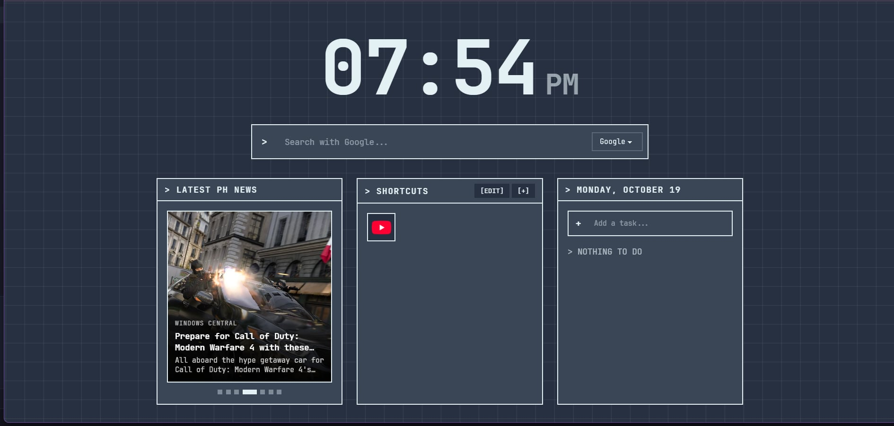

# Hsoj-Tab

A minimalist new-tab page with a clock, search, news, shortcuts, and a todo list, styled to match my personal site.

## Try it!
Visit [Hsoj-Tab](https://hsoj.is-a.dev/projects/hsoj-tab)

## Features

- **Clock**: a 12-hour clock with AM/PM.
- **Search**: search with Google, DuckDuckGo, or Bing. Your chosen engine is remembered.
- **Latest News**: English-language Philippine headlines that rotate every 5 seconds. Hover to pause, or click the dots to jump to a story.
- **Shortcuts**: add your favorite sites. Icons are fetched automatically from each site's favicon, and edit mode lets you remove them.
- **Todo**: a simple daily task list with the current date as its header.
- **Private by default**: shortcuts, todos, and search engine are saved in your browser's localStorage. Nothing is sent to a server.

## Credits

- [FreeNewsApi.io](https://www.freenewsapi.io) for the news data
- [Google Favicon Service](https://www.google.com/s2/favicons?domain=example.com) for shortcut icons

---

Made with 💖 by [Hsoj-dev](https://github.com/hsoj-dev)
